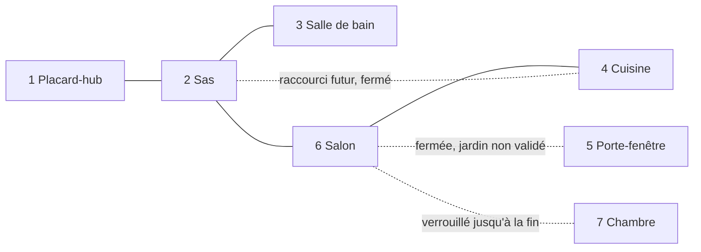

# Appartement — blockout 3D (lot 4)

Première matérialisation **jouable en mode développement** de l'appartement complet, autour du placard-hub existant. C'est un *blockout* : volumes, sols, murs, plafonds, ouvertures et collisions, avec des couleurs provisoires par pièce et quelques volumes de mobilier gris pour juger l'échelle. Aucune décoration définitive, aucune énigme, aucune créature, aucun contenu narratif.

> Les zones, leurs rôles et leurs connexions sont **validés** (voir GDD §5.1). **La disposition et toutes les dimensions ci-dessous sont des propositions provisoires**, à valider.

## Fichiers

| Fichier | Rôle |
|---|---|
| `scenes/levels/workshop.tscn` | Placard-hub (zone 1) et **première démo**, inchangés. Reste la scène principale du jeu. |
| `scenes/levels/apartment_blockout.tscn` | Zones 2 à 7 : sols, murs, plafonds, ouvertures, volumes, lumières, étiquettes, zones, points d'apparition, connexions. |
| `scenes/levels/apartment.tscn` | **Mode développement** : instancie le placard tel quel + le blockout. |
| `scripts/dev/apartment_dev.gd` | Outils du mode développement (zones, carte, plafonds, caméra libre). |
| `tests/test_apartment.tscn` | Test automatique de la carte. |

## Plan (vue de dessus, nord en haut)

Coordonnées en unités Godot (1 unité = 10 cm). Le placard garde exactement sa position.

```
x :   -75          -45          -15           15           45
z-35  ┌────────────┐                          ┌────────────┐
      │ 3 Salle de │      (extérieur :        │ 7 Chambre  │
      │    bain    │       vue de la          │ verrouillée│
z-15  │            ├────────────┬─────────────┤            │
      │            D            │             │            │
      │            │   2 Sas    D 1 Placard   │            │
z  0  ├────────────┤            │  -hub       │            │
      │ 4 Cuisine  ⊘ raccourci  │  (démo)     │            │
      │            │            │             │            │
z 12  │            ├─────D──────┴─────────────┴─────≋──────┤
      │            │                 6 Salon                │
      │            D     étape A        │      étape B      │
      │            │                    ┊ (retombée)        │
z 57  └────────────┴──────────▒▒▒▒▒─────┴───────────────────┘
                         5 porte-fenêtre → jardin (non jouable)
```

D = passage ouvert · ⊘ = raccourci futur, porte fermée · ≋ = rideau japonais, verrouillé · ▒ = porte-fenêtre fermée.

## Schéma des connexions



Aucune autre ouverture n'existe. Le placard partage des murs pleins avec le salon et la chambre (pas de porte).

## Dimensions retenues [PROPOSITION]

| Zone | Intérieur (x × z) | Remarque |
|---|---|---|
| 1 Placard-hub | 3,00 × 2,70 m | Existant, inchangé |
| 2 Sas | 2,94 × 2,70 m | Petite transition ; meuble à chaussures |
| 3 Salle de bain | 2,94 × 3,44 m | Baignoire, meuble lavabo, WC (volumes) |
| 4 Cuisine | 2,94 × 5,70 m | Plan de travail, placards hauts, réfrigérateur, table |
| 5 Porte-fenêtre | 2,00 m de large, 2,15 m de haut | Ouverture du salon, pas une pièce |
| 6 Salon | 9,00 × 4,44 m | Plus grande pièce, allongée ; étape A (ouest) et étape B (est), séparées partiellement par un meuble bas et une retombée de plafond |
| 7 Chambre | 2,94 × 4,70 m | Lit, armoire (volumes) ; inaccessible |

- Hauteur sous plafond : **2,40 m** partout (comme le placard). Murs : 6 cm (épaisseur du placard, conservée pour la cohérence).
- Portes : **0,90 × 2,08 m** (comme la porte du placard) ; passage salon ↔ cuisine 1,10 m ; rideau 1,00 m.
- Emprise totale : environ 12,1 × 9,3 m.
- À l'échelle de Nin0 (5 cm) : le salon fait 180 fois sa longueur ; un plan de travail (90 cm) représente 18 fois sa hauteur.
- Porte du placard : désormais **entrouverte de 20°** une fois ouverte, juste assez pour laisser passer Nin0 (testé).

## Préparé pour la suite

- **Raccourci sas ↔ cuisine** : vraie ouverture dans le mur, fermée par une porte (collision). L'énigme d'ouverture n'est pas définie.
- **Accès à la chambre** : rideau japonais jusqu'au sol, doublé d'un verrou invisible ; inaccessible même en sautant (testé).
- **Porte-fenêtre** : vantaux vitrés fermés et verrou ; un simple sol vert à l'extérieur indique le jardin, sans niveau extérieur.
- **Verticalité** : volumes de mobilier aux hauteurs réelles (plans de travail 90 cm, placards hauts, bibliothèque 1,80 m, armoire 2 m, baignoire, lit). Les espaces dessous, les dessus et les écarts entre les volumes restent libres pour les futurs chemins. Ce sont des **volumes provisoires**, pas un aménagement validé.
- **Deux étapes dans le salon** : une seule pièce, deux secteurs de même taille, marqués par un meuble bas (1 m) et une retombée de plafond, avec un large passage commun.
- Six souvenirs, créatures, énigmes et musiques de zone : **non placés**, volontairement.

## Mode développement

Ouvrir `scenes/levels/apartment.tscn` et lancer la scène courante (**F6**). La scène principale (**F5**) reste la démo du placard.

| Touche | Action |
|---|---|
| 1 à 7 (rangée du haut ou pavé numérique) | Aller à une zone (Nin0 téléporté, point sûr mis à jour) |
| F1 | Aide |
| F2 | Carte vue de dessus (zones, connexions vert/rouge, position de Nin0) |
| F3 | Masquer / afficher les plafonds |
| F4 | Caméra libre (Z Q S D, Espace / C pour monter et descendre, Maj pour aller vite) |

- Démarrer dans une zone : propriété **Start Zone** du nœud racine, ou argument `-- --zone=6`.
- Nin0 démarre complet (roues, jambes, vision focalisée), énigmes du placard résolues, porte entrouverte.
- **Aucune sauvegarde** n'est écrite ni effacée (`GameState.dev_mode`), et la progression du joueur n'est pas modifiée. La chambre reste physiquement verrouillée ; la touche 7 permet seulement de vérifier ses dimensions en développement.
- Le décor provisoire du sas et le seuil bloqué de la démo sont retirés **uniquement dans cette scène**.
- Les étiquettes 3D (numéro, nom, état) n'existent que dans le blockout.

## Hypothèses architecturales à valider

1. Disposition : salle de bain au nord-ouest, cuisine à l'ouest sur toute la profondeur, salon au sud sur toute la largeur, chambre au nord-est, porte-fenêtre au sud du salon.
2. Le sas touche la salle de bain et la cuisine par son mur ouest (porte ouverte et raccourci fermé) et le salon par son mur sud.
3. Le placard est mitoyen du salon (mur sud) et de la chambre (mur est), sans ouverture.
4. Dimensions et hauteur unique de 2,40 m ; épaisseur des murs (6 cm) plus faible que dans la réalité, pour rester cohérente avec le placard.
5. Le salon : séparation des deux étapes par un meuble bas et une retombée (pas de cloison).
6. La porte du placard entrouverte de 20° remplace l'ouverture à 80° (aussi dans la démo).
7. Volumes de mobilier : placeholders pour l'échelle, librement déplaçables ou supprimables.

## Tests

`tests/test_apartment.tscn` (51 vérifications, Godot 4.7, sans affichage) :

- placard intact, démo inchangée ;
- sept zones, dimensions, sol à 0 et plafond à 2,39 m ;
- **passages réels sur roues** : placard → sas (porte entrouverte), sas → salon, sas → salle de bain, salon → cuisine, retours vers le sas et le placard, étape A → étape B ;
- accès bloqués : raccourci, rideau (même en sautant), porte-fenêtre ;
- téléportation dans chaque zone avec la caméra hors des murs ; touches 3, F2, F3, F4 ;
- aucune sauvegarde écrite, sauvegarde personnelle intacte.

## Problèmes connus

- Murs et volumes en couleurs unies, éclairage provisoire (une lampe par pièce, sans ombres). Le soleil du placard calcule ses ombres jusqu’à 60 unités de la caméra seulement : quelques taches lumineuses peuvent apparaître dans les pièces fermées. Ce réglage n’a pas été modifié pour ne pas toucher au rendu de la démo.
- Pas de plinthes, de portes battantes ni de détails (blockout).
- L'extérieur se limite au décor du placard (façade, arbre) et au sol du jardin.
- Le placard garde ses propres murs : quelques arêtes de murs se superposent légèrement aux jonctions avec le blockout (sans effet sur les collisions).
