# Chapitre 2 — Le territoire des fourmis (lot 5)

Suite jouable de la première démo : Nin0 franchit la porte du placard, découvre le sas, la colonie de fourmis de la salle de bain, affronte la reine dans le lavabo, fabrique un canon à l'imprimante et ouvre la porte de la cuisine. **Le chapitre se termine à l'entrée de la cuisine** ; le salon reste fermé.

> Statuts : **[DÉVELOPPÉ]** = jouable et testé automatiquement ; **[PROPOSITION]** = choix technique ou de mise en scène pris pour avancer, à valider ; **[À DÉFINIR]** = décision ouverte, rien n'est inventé.

## Lancer

| Scène | Usage |
|---|---|
| `scenes/levels/game.tscn` | **Jeu complet** (scène principale, F5) : écran titre, placard, puis l'appartement. |
| `scenes/levels/workshop.tscn` | Première démo seule (inchangée, fin au seuil du sas). |
| `scenes/levels/apartment.tscn` | Mode développement (F6) : jeu complet, placard résolu, aucune sauvegarde, scénarios de test. |

### Commandes ajoutées

| Touche (AZERTY) | Action |
|---|---|
| Clic gauche ou X | Tirer une bille (canon installé) |
| Clic droit / Maj (maintenir) | Vision focalisée : analyser un insecte, repérer le loquet, viser plus précisément |
| Tab ou I | Inventaire (Ressources, Équipement, Archives, Bestiaire) ; aussi depuis la pause |
| Q / D (inventaire ouvert) | Changer d'onglet |

### Mode développement — scénarios (aucune sauvegarde)

| Touches | Scénario |
|---|---|
| Ctrl + 1 | Rencontre de la première ouvrière (entrée du sas) |
| Ctrl + 2 | Labyrinthe gauche (souvenir n° 2) |
| Ctrl + 3 | Labyrinthe droit (soldats) |
| Ctrl + 4 | Pied de l'escabeau |
| Ctrl + 5 | Haut de l'escabeau, juste avant la reine |
| Ctrl + 6 | Fabrication du canon (devant l'imprimante, reine vaincue, filament fourni) |
| Ctrl + 7 | Porte de la cuisine (canon installé, billes fournies) |

En ligne de commande : `-- --scenario=boss` (sas, maze, right, stool, boss, cannon, kitchen) ; `-- --zone=3` reste disponible.

## Déroulement

1. **Sas** [DÉVELOPPÉ] — décor abandonné (poussière, taches d'humidité, fissures, meuble à chaussures, parapluie tombé, feuille morte, éclats de plâtre, paillasson, porte-manteau), lumière mesurée. En entrant, **une ouvrière traverse, découvre Nin0, s'arrête**, agite ses antennes, penche la tête ; silence ; elle repart (≈ 4,5 s sans contrôle). Elle n'attaque jamais.
2. **Analyse** [DÉVELOPPÉ] — pensée et indice discret pour la vision focalisée ; une ouvrière visée assez longtemps est identifiée : fiche **« ESPÈCE IDENTIFIÉE »** (nom, classification, activité, comportement, particularité). Pensées « Cette carapace… » → « Elle la protège ? » → « Une protection… mécanique ! » → écran de plan **ARMURE I**.
3. **Colonne d'ouvrières** [DÉVELOPPÉ] — de la fissure du mur ouest jusqu'au trou du nid sous un carreau cassé de la salle de bain : transport de débris et de nourriture, pauses, échanges, écarts, vitesses variées, réactions ponctuelles à Nin0. Elle guide vers la salle de bain sans texte.
4. **Portes** [DÉVELOPPÉ] — salon : fermée, examinable (« Fermée… », « Pas par là. Pas encore. »), aucun mécanisme. Cuisine : fermée par un **crochet** posé haut sur le chambranle, examinable, repérable à la vision focalisée (« Trop haut pour moi. »).
5. **Salle de bain** [DÉVELOPPÉ] — carrelage, baignoire, WC, meuble-lavabo avec miroir, linge entassé, serviette pendue, humidité. Un **pantalon abandonné** sépare l'entrée en deux :
   - **à gauche**, petit labyrinthe facultatif (flacons couchés, rouleaux, panier, seau, gel douche, boîte de cotons, lessive, porte-savon sur pieds à passer dessous ou dessus) ; deux culs-de-sac récompensés (plastique, filament) ; le **ticket froissé** (souvenir n° 2) dans le recoin près de la poche du pantalon ;
   - **à droite**, galeries de terre gardées par **quatre soldats** : gravier (ralentit les roues), marche de carrelage avec rampe, passage étroit entre deux cailloux, carrelage soulevé (jambes), larves qui tombent de la galerie bâtie dans la serviette ; une poche gardée près du WC (ressources) ; puis l'escabeau.
6. **Escabeau** [DÉVELOPPÉ] — carton, gant + rouleau, marche 1, gobelet, flacon, marche 2, porte-savon, gants pliés, plateau, boîte, pile de livres, rebord du plan (85 cm). Montées de 0,75 u au plus (saut : 1 u), deux points sûrs (pied et haut de l'escabeau).
7. **Reine** [DÉVELOPPÉ] — courte présentation (elle se redresse, grogne ; Nin0 surpris ; contrôle rendu). La vasque est remplie de matière visqueuse : Nin0 s'y enfonce lentement, ralentit, saute moins haut et reçoit plus de dégâts, mais peut toujours en sortir. Débris flottants (éponge, bouchons, coton, savon, tesson), deux qui dérivent. Attaques : **crachat d'acide** (préparation 1 s, cible verte au sol, arc lisible, 12 dégâts, ralentissement 1,6 s, petite flaque) préféré à distance ; **morsure** au contact (préparation 1 s, portée 1,5 u, 30 dégâts, récupération 1,5 s).
8. **Victoire sans arme** [DÉVELOPPÉ] — traverser jusqu'à l'**anneau de la chaînette** sur le rebord est et le tirer (E) : la bonde saute, gargouillis, la matière s'évacue (6 s), les débris descendent, l'île glisse, **la reine perd pied et est emportée vers la bonde en tournoyant** (sobre, sans mort graphique). Nin0 surpris puis content. Victoire définitive.
9. **Plan du canon** [DÉVELOPPÉ] — « Elle projetait… », « Un ressort… une bille… » → écran **CANON À PROJECTILES PLASTIQUES** (pictogrammes, schéma : goutte projetée → ressort → tube → bille).
10. **Imprimante** [DÉVELOPPÉ] — carte « Canon à billes » ; impression couche par couche sur le plateau, présentation, Nin0 monte, la tête saisit la pièce et l'emboîte sur son épaule droite, petit recul, réaction ; 6 billes offertes ; indice de tir.
11. **Cuisine** [DÉVELOPPÉ] — retour au sas, une bille soulève le crochet : déclic, la porte s'entrouvre lentement vers la cuisine éclairée. Entrer dans la cuisine (intérieur en blockout) termine le chapitre : écran « Chapitre 2 terminé — Le territoire des fourmis », avec **Continuer à explorer**.

Retour au placard possible à tout moment (portes ouvertes dans les deux sens), y compris avant la reine ; rien n'est réinitialisé par une visite au placard.

## Systèmes

### Fourmis
- `AntBody` (procédural, cartoon) : 6 pattes avec démarche en trépied, 2 antennes, grands yeux, mandibules ; ouvrière (≈ 1,8 cm), soldat (tête large, grosses mandibules, sourcils, ≈ 2,6 cm), reine (gros abdomen rayé doré, moignons d'ailes, ≈ 12,5 cm).
- Ouvrière (`AntWorker`) et colonne (`AntColumn`) : mise à jour réduite à 4 Hz et animation coupée loin de Nin0.
- Soldat (`AntSoldier`) : patrouille → alerte (« ! ») → poursuite (≈ vitesse des jambes) → préparation de morsure → morsure (14) → récupération → recherche (« ? ») → retour. Vue limitée (4 u, 75°, même niveau, ligne de vue). Une bille le fait reculer ; trois billes le font fuir, il revient plus tard.
- Les ouvrières restent pacifiques ; l'ancien « incident → hostilité générale » n'est pas implémenté pour ce chapitre (GDD §6).

### Roues ou jambes
Roues : plus rapides en terrain dégagé (sas, entrée, labyrinthe gauche). Gravier : roues à 40 %. Marches, carrelage soulevé, escabeau et lavabo : jambes. Soldats : vitesse ≈ jambes, donc on les distance sur roues en terrain dégagé.

### Intégrité et dégâts
`NinoIntegrity.hit()` : courte invulnérabilité (0,9 s), recul, émotion. Matière : dégâts ×1,25. Armure I : −25 % sur les dégâts physiques (pas sur l'acide). À zéro : mise en veille, redémarrage au dernier point sûr ; pendant la reine, l'arène est entièrement remise en place.

### Canon
`NinoCannon` (nœud ajouté par le jeu complet) : vise le centre de la caméra (premier obstacle sur la ligne de visée), compatible avec la vision focalisée ; bille physique (14 u/s, légère gravité, portée 20 u), collision avec le monde, les créatures (couche 5) et les cibles (couche 6) ; `on_projectile_hit()` ou métadonnée `projectile_receiver`. Munitions : `AmmoData` (`assets/upgrades/ammo_bead.tres`) ; un seul type développé, un type 2 (pointu) prévu [NON DÉVELOPPÉ].

### Ressources, réapparition
Voir GDD §4.3. Identifiants uniques par objet ; `GameState.pickup_times` mémorise l'heure de jeu du ramassage ; réapparition à au moins 8 u de Nin0.

### Inventaire
`InventoryMenu` (Tab / I ou pause) : quatre onglets construits à partir de `GameState`, `UpgradeCatalog`, `SpeciesCatalog`, `MemoryArchive`. Les archives montrent pour chaque souvenir l'objet associé, les informations récupérées (dégradées selon le nombre de souvenirs), toutes les interprétations de Nin0 (historique) et ce qui reste inconnu ; les souvenirs non trouvés sont des « signaux non identifiés ».

### Sauvegarde (version 5)
Ajouts : espèces, plans, améliorations, modules équipés, rencontre, salle de bain, reine (combat commencé, vaincue), cuisine, chapitre, plastique, temps de jeu, heures de ramassage, notifications vues, lectures des souvenirs, point de reprise (sas, salle de bain, pied ou haut de l'escabeau, porte de la cuisine). Les sauvegardes des lots 1 à 4 se chargent (valeurs par défaut).

## Fichiers principaux

| Fichier | Rôle |
|---|---|
| `scenes/levels/game.tscn`, `scripts/zones/game_world.gd` | Jeu complet, chef d'orchestre du chapitre |
| `scenes/zones/sas_zone.tscn`, `scripts/zones/sas_zone.gd`, `kitchen_door.gd` | Sas, portes |
| `scenes/zones/bathroom_zone.tscn`, `scripts/zones/bathroom_zone.gd` | Salle de bain |
| `scripts/zones/sink_arena.gd`, `floating_platform.gd`, `terrain_zone.gd`, `larva_dropper.gd` | Arène, débris, terrains, larves |
| `scripts/creatures/*.gd`, `assets/species/*.tres` | Fourmis, fiches d'espèces |
| `scripts/weapons/*.gd`, `scripts/props/cannon_model.gd` | Canon, munitions |
| `scripts/ui/species_card.gd`, `blueprint_screen.gd`, `inventory_menu.gd`, `chapter_end.gd` | Interfaces |
| `tests/test_chapter2.tscn` | Test automatique du chapitre |

Les scènes de zones sont produites par des générateurs Python hors dépôt (blockout + accessoires simples) ; elles restent éditables dans Godot.

## Décisions prises pour avancer [PROPOSITION, à valider]

- Vidange : chaînette reliant la bonde à un anneau sur le rebord est ; le tour par les rebords est bloqué par le robinet et le distributeur de savon (il faut traverser la vasque).
- Défaite de la reine : emportée vers la bonde en tournoyant et en rétrécissant (cartoon, sobre).
- Après une défaite : reprise en haut de l'escabeau ; présentation raccourcie aux essais suivants.
- Canon : 6 billes offertes à la fabrication ; une bille = un plastique ; 24 au maximum.
- Coûts : Armure I et canon 3 fragments chacun.
- Le labyrinthe gauche et le souvenir n° 2 restent accessibles avant et après la reine.
- Musique : voir « Lot 5.1 » ci-dessous.

## Limites connues

- Graphismes : accessoires en volumes simples (boîtes, cylindres, sphères), sans textures ; les galeries de terre sont des volumes arrondis.
- La colonne et les soldats ne contournent pas les obstacles par navigation : leurs trajets sont posés à la main ; un soldat coincé abandonne et reprend sa patrouille.
- Musiques de zone : le système est prêt, mais seuls les fichiers fournis sont joués (voir `assets/music/LISEZMOI.md`) ; effets sonores et jingles synthétiques.
- La caméra peut passer derrière des accessoires dans les galeries étroites (pas de transparence des obstacles).
- Les validations automatiques ne remplacent pas un essai à la manette / au clavier sous Windows (sensations, lisibilité, difficulté).

## Lot 5.1 — corrections après le premier essai manuel [DÉVELOPPÉ, en attente d'un nouveau test]

### Musique
- **Bug corrigé** : l'introduction continuait pendant le jeu. Elle se joue maintenant à l'écran titre seulement ; au début du gameplay (réveil, Continuer, mode développement) elle s'arrête par un fondu et **« Petit Refuge »** prend le relais.
- Une seule musique de zone à la fois : deux lecteurs servent uniquement au fondu enchaîné (0,8 s ; 1,2 s vers le boss). Demander le morceau déjà en cours ne fait rien : **aucun redémarrage** entre le placard et le sas ni lors d'une interaction.
- Choix par zone (`GameWorld.music_for_state`) : combat de la reine > salle de bain (« ant labyrinth », V3) > cuisine (« kitchen », lot 6) > placard et sas (« Petit Refuge »). La musique du boss démarre **au moment où la reine se redresse** dans la mini-cinématique ; après la victoire (une fois le plan du canon obtenu) ou après un échec, retour aux labyrinthes.
- Pause : la musique continue (bus séparé) ; chargement : la zone de reprise choisit le morceau.
- Volume musical indépendant des effets (bus Music / Sfx).
- **Fichiers non encore fournis** : Petit Refuge, ant labyrinth V3, boss fight V2, kitchen. Le système joue du silence à leur place ; ils seront joués dès qu'ils seront déposés sous les noms de `assets/music/LISEZMOI.md`. Ces morceaux ne sont donc **pas** intégrés à ce jour.

### Jingles de découverte (originaux, synthétisés)
- **A — scan terminé** : signal électronique puis arpège montant (≈ 1,4 s), à la première identification d'une espèce.
- **B — nouveau plan** : courte phrase chaleureuse qui se pose sur un accord (≈ 2 s), à chaque plan débloqué (Renfort, Armure I, canon).
- **C — amélioration installée** : notes ascendantes rapides et accord (≈ 1,4 s), à l'installation des jambes, du Renfort, d'Armure I et du canon.
- La musique s'efface brièvement (−12 dB) puis revient ; chaque découverte étant unique, chaque jingle n'est joué qu'une fois par découverte.

### Labyrinthes
- Les murs de terre du chemin droit sont devenus du **linge** : piles de vêtements pliés (couches arrondies, plis visibles, couleurs naturelles), serviettes pliées surmontées de serviettes roulées, gros tas de linge pour les zones fermées, chiffons et tee-shirts tombés au sol ; quelques miettes de terre au sommet rappellent les galeries des fourmis. Collisions : boîtes invisibles de même emprise qu'avant (parcours inchangés).
- Chemin gauche : la boîte de lessive et la boîte de cotons sont devenues des piles de serviettes et de vêtements pliés ; le paquet de rouleaux a ses quatre rouleaux visibles. Il reste reconnaissable (objets de salle de bain, couleurs claires) face au chemin droit (linge et terre de la colonie).

### Soldats (4 → 10, IA inchangée)
| Soldat | Chemin | Rôle |
|---|---|---|
| SoldierLeftSouth | gauche, couloir sud | longue patrouille jusqu'au cul-de-sac (plastique) |
| SoldierLeftCenter | gauche, couloir central | patrouille transversale |
| SoldierLeftUpper | gauche, couloir haut | garde l'approche du recoin du ticket (sans s'y poster) : on passe quand elle tourne le dos |
| SoldierGravel | droit, gravier | inchangé |
| SoldierStep | droit, jonction gravier / marche | nouvelle |
| SoldierCorridor | droit, couloir de la marche | inchangé |
| SoldierPebbles | droit, avant les cailloux | nouvelle |
| SoldierToilet | droit, poche du WC | inchangé |
| SoldierVanity | droit, devant le meuble | inchangé |
| SoldierTowel | droit, sous la serviette (larves) | nouvelle, la plus proche de l'escabeau |
- Tous patrouillent (aucun garde immobile), leurs trajets sont vérifiés sans obstacle, aucun n'est posté à moins de 3 u du ticket ni des points sûrs. Après une mise en veille, les soldats reviennent à leur poste et ignorent Nin0 2,5 s (récupération après une erreur). Dégâts des soldats inchangés.

### Reine
- **Mobile** dans toute la vasque (zone praticable bornée : matière, débris, éponge), à 0,7 u/s (0,85 quand elle vient chercher Nin0), virages lents d'un gros insecte. Elle se replace à distance de crachat (2,2 à 3,4 u), vient chercher Nin0 s'il reste 3 s au même endroit ou s'éloigne trop, et se repositionne souvent après une attaque. Elle ne sort pas de la vasque, ne traverse pas Nin0 (elle le repousse doucement) et ne peut pas atteindre l'anneau (sur le rebord).
- **Dégâts relevés** : acide 12 → 18 (ralentissement 2 s au lieu de 1,6 ; dans la matière ×1,25), morsure 30 → 42 (préparation allongée de 1,0 à 1,1 s, récupération 1,5 s). Sans Armure I, deux morsures dans la matière mettent Nin0 en veille : il faut bouger. Victoire toujours possible sans arme ni armure (test automatique).
- Elle est cachée dans la matière avant la première rencontre ; une bille la fait sursauter, sans dégâts.

### Mises en scène
- **Début (première fois, ≈ 6 s)** : caméra de mise en scène (travelling sur l'arène) ; bulles, la reine émerge de la matière et monte sur son éponge ; gros plan : elle remarque Nin0 (« ! ») ; elle se redresse et grogne — la musique du combat démarre ; plan sur Nin0 surpris ; caméra et contrôle rendus. Essais suivants : grognement et musique, 0,8 s.
- **Fin** : Nin0 tire la chaînette ; gros plan sur la bonde qui saute ; travelling pendant la vidange (6 s) ; la reine réagit (« ?! »), court vers son éponge, vacille, s'accroche, puis le courant l'emporte en tournoyant vers la bonde ; plan sur Nin0 qui constate le lavabo vide ; puis son raisonnement vers le plan du canon. Interface masquée pendant ces plans.

### Première ouvrière
- Après l'arrêt de l'ouvrière : Nin0 l'observe, **ses yeux se calibrent** (deux plissements, déclic optique), pensée **jumelles + fourmi** ; le contrôle revient ; une **cible pulsante** apparaît sous l'ouvrière (et son repère dans la vision focalisée) avec l'indication « Maintenez clic droit : vision focalisée — visez la fourmi ». L'ouvrière **attend** jusqu'à 14 s (tant que Nin0 reste à moins de 3,5 u). Le scan n'est jamais automatique. Après l'analyse : jingle, fiche, réaction à l'exosquelette, plan Armure I ; puis elle repart.

## Finitions après validation (branche `claude/lot6-cuisine-finitions`) [DÉVELOPPÉ, à retester]

Le chapitre 2 a été validé par le créateur et fusionné dans `main` (PR #1). Ces finitions le polissent sans le reconstruire.

### Bugs corrigés
- **Souvenirs dangereux** : pendant un souvenir (et toute séquence sans contrôle : installations, mises en scène, réflexions, rencontre de l'ouvrière, cinématiques de la reine, mise en scène du verrou), les dangers sont **suspendus** par un mécanisme réutilisable (`GameState.suspend_hazards` / `resume_hazards`, un verrou par séquence) : soldats immobilisés (une morsure en préparation est annulée), reine figée, larves arrêtées, acide et flaques sans effet, plus d'enlisement, aucune attaque ne touche (`NinoIntegrity.hit`). L'interface et les effets visuels continuent (pas de pause globale). À la reprise : 1 s de protection et les soldats attendent 1 s avant de reprendre.
- **Objet étrange traversable** : la **boule de papier du sas** (`Decor/PaperBall`, `sas_zone.tscn`) était une sphère lisse sans collision. Elle devient une boule de papier froissé à facettes, avec traces d'encre, et une vraie collision (cylindre). Autres cas trouvés : le second caillou des galeries (`PebbleB`) n'avait pas de collision (ajoutée) ; les chiffons au sol, simples ellipses, deviennent de vrais tissus pliés posés à plat (sans collision : Nin0 roule dessus comme sur un tissu).
- **Plateau de l'imprimante** : son corps de collision (`Bed/BedBody`) ne suivait pas le plateau visible (synchronisation physique, même défaut que la porte du placard au lot 4) ; Nin0 pouvait flotter, glisser ou traverser. Corrigé (`sync_to_physics = false`).
- **Verrou de la cuisine trop haut** : la caméra ne montait qu'à 30°. En vision focalisée (vue subjective), on peut maintenant lever les yeux jusqu'à 62° ; les billes compensent la gravité pour arriver au point visé ; une aide à la visée légère (6°) cible les mécanismes ; voir la mise en scène ci-dessous.
- Parapluie du sas réorienté (il traversait la pièce, dès le lot 5).

### Musique
Pack intégré (voir `assets/music/LISEZMOI.md`) : « Petit Refuge » (intro + boucle), « ant labyrinth » V3 (intro + boucle), « boss fight » V2 édité (intro + deux sections en boucle, la fin n'est jamais jouée), « kitchen » prête pour le lot 6, « living room » rangée hors du jeu. Volumes équilibrés par piste. L'introduction s'efface dès le début du réveil, pendant que « Petit Refuge » arrive (fondu de 4 s) : le réveil allongé accompagne la transition sans la masquer.

### Réveil et tutoriel
- Réveil progressif (≈ 10 s de jeu, contre ≈ 5,5 s) : l'écran du visage s'allume par à-coups, étourdissement, surprise, regards à gauche, à droite, vers la lumière, vers le bas, Nin0 s'ébroue sur ses roues, puis la caméra se place.
- Nin0 se réveille dans un **bac de recharge à rebords** (0,24 u, infranchissable sur roues) : il y apprend **avancer, reculer, tourner, orienter la caméra**. À la fin, la rampe avant s'abaisse et les autres rebords se rétractent dans le socle : l'établi redevient libre. Le bac est ouvert d'emblée en reprise de partie.

### Vision focalisée au rebord
Nin0 regarde à gauche, à droite, fixe quelque chose au loin, penche la tête, réfléchit (pensées œil + interrogation, puis œil + idée), plisse les yeux, puis le calibrage optique et le tutoriel apparaissent. Règles d'observation inchangées.

### Personnalité de Nin0
- `NinoReactions` : réactions brèves selon le contexte — objet inconnu (curiosité), déjà vu (reconnaissance : petit hochement, sans répéter la pensée), créature pacifique (intérêt), danger (inquiétude, à chaque alerte d'un soldat), découverte (satisfaction), échec (frustration légère : mise en veille, canon vide), amélioration (enthousiasme + « Yeeeaah ! »), objet étrange (hésitation : portes fermées), événement incompréhensible (larve qui tombe tout près). Chaque type a son délai et une part de hasard pour les pensées : Nin0 ne commente pas tout. Petits regards autour de lui au repos.
- Quatre nouvelles expressions composées (inquiet, frustré, hésitant, enthousiaste) et petits sons robotiques.
- Les objets examinables n'affichent plus tous « Examiner » : Observer, Regarder de plus près, Inspecter, Jeter un œil… puis « Revoir » une fois découverts.

### Première ouvrière
Après l'arrêt : Nin0 l'observe, elle penche la tête, puis **s'approche prudemment, antennes tendues** vers lui, Nin0 sursaute, elle recule d'un pas ; calibrage des yeux, pensée jumelles, cible au sol ; elle **attend jusqu'à 25 s**. Toujours aucun scan automatique.

### Sons
Petite voix robotique originale « Yeeeaah ! » (synthèse de formants i → a, ≈ 0,75 s), jouée après chaque installation d'amélioration. Jingles inchangés (scan, plan, installation).

### Verrou de la cuisine
Au retour dans le sas avec le canon : Nin0 regarde la porte, une caméra de mise en scène montre le crochet (qui se met à luire), « Ce crochet… », puis « Avec mon canon ! ». Contrôle rendu, un **repère lumineux au sol** indique une position de tir d'où le crochet se vise à ≈ 50° en vision focalisée. Le joueur tire lui-même. La porte ne s'entrouvre plus que de **16°** (au lieu de 34°) : juste assez pour passer, la cuisine reste dans la pénombre.

### Plastique à munitions
Nouvel aspect : amas de filament extrudé (« poop » d'impression) — tortillons bleus, cyan et blancs emmêlés autour d'une petite masse fondue. Le filament de réparation garde sa spirale orange. Compteurs, inventaire et réapparition inchangés.

### Labyrinthe : légère extension
L'ancienne zone fermée derrière le couloir de la marche devient l'**alcôve du linge** (≈ 0,8 × 0,5 m à l'échelle humaine) : entrée depuis le couloir de la marche ; refuge en hauteur fait de piles de vêtements en escalier (0,5 / 1,0 / 1,5 u, les soldats ne détectent pas Nin0 là-haut) ; plastique au sommet, filament au sol ; sortie vers l'escabeau sous une serviette tendue à 0,6 u (en roues seulement). Les deux branches, le ticket et l'escabeau sont inchangés.

### Reine
Combat inchangé. Dans le liquide seulement (plus sur les débris) : vitesse ×0,38, **accélération ×0,3** (inertie), enfoncement plus profond (0,2 u) et plus rapide, éclaboussures quand Nin0 avance, saut réduit, dégâts ×1,25. Les débris flottants sont de vrais refuges. Les dangers sont suspendus pendant les cinématiques de début et de fin.

### Captures du lot 5.1

| | | |
|---|---|---|
| 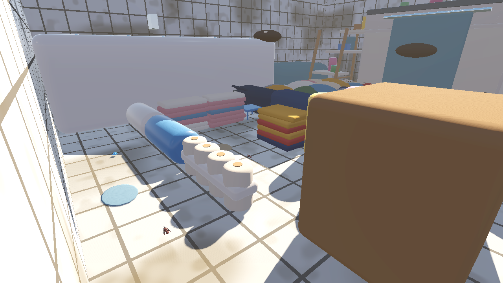 | 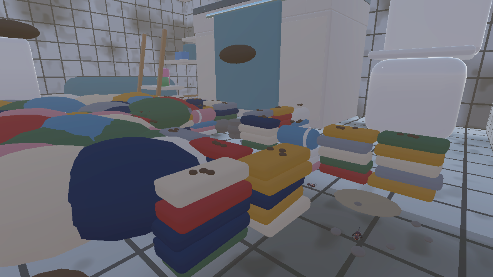 | 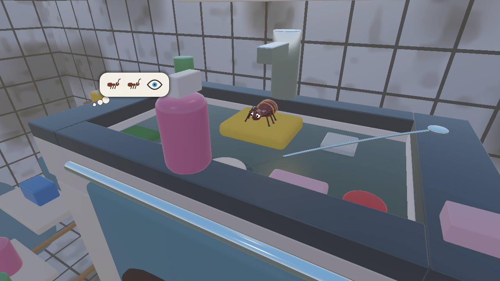 |
| Chemin gauche : serviettes, vêtements pliés, rouleaux | Chemin droit : galeries de linge | Vue de la mini-cinématique |

## Captures (rendu Godot 4.7, OpenGL, sans interface)

| | |
|---|---|
| 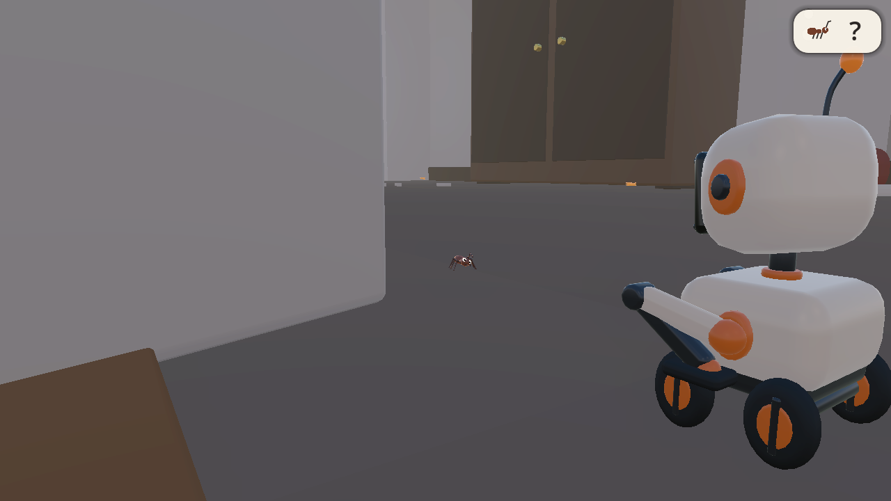 | 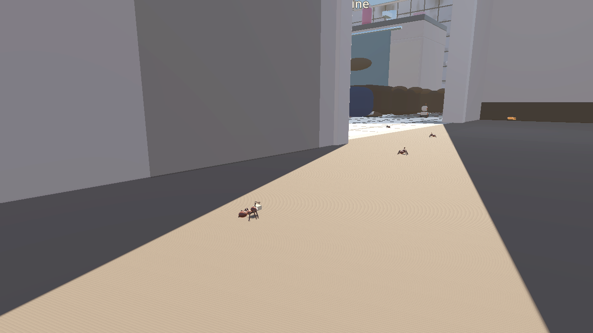 |
| Première ouvrière (Nin0 intrigué) | Colonne vers la salle de bain |
| 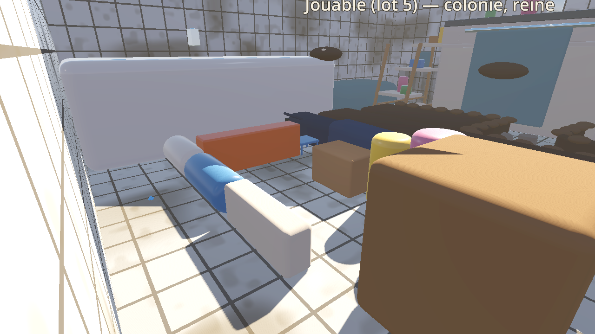 | 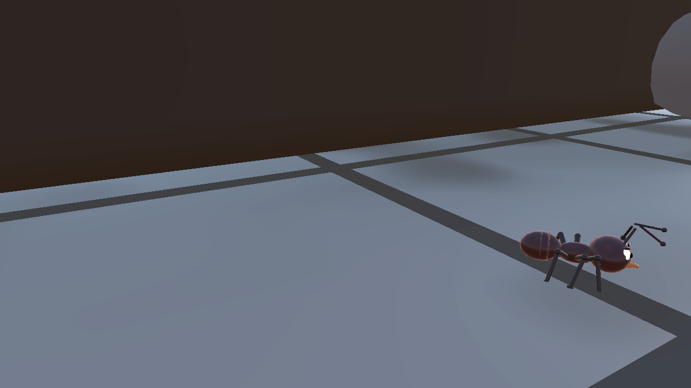 |
| Labyrinthe gauche | Soldat en patrouille |
| 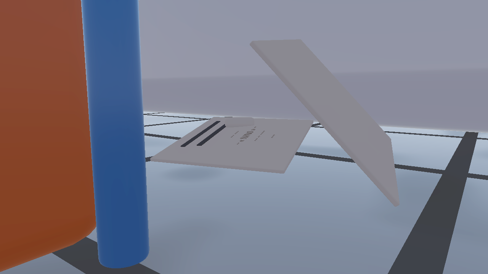 | 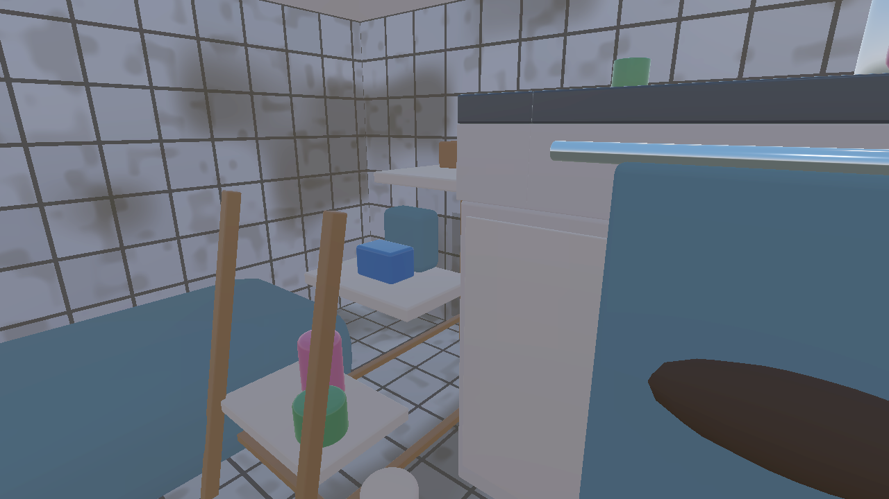 |
| Ticket froissé (souvenir n° 2) | Escabeau et appuis |
| 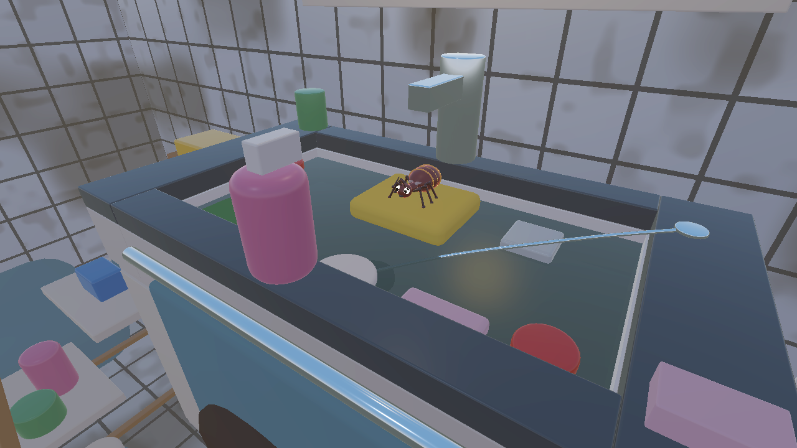 | 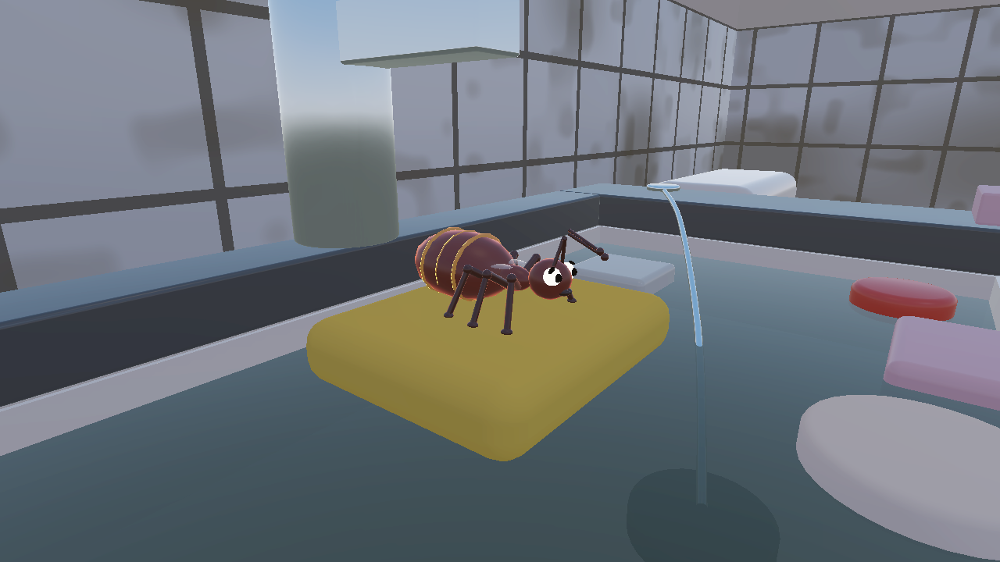 |
| Arène du lavabo | La reine sur son éponge |
| 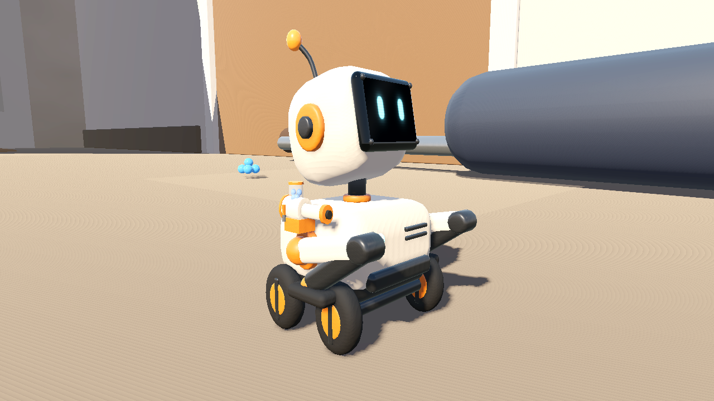 | 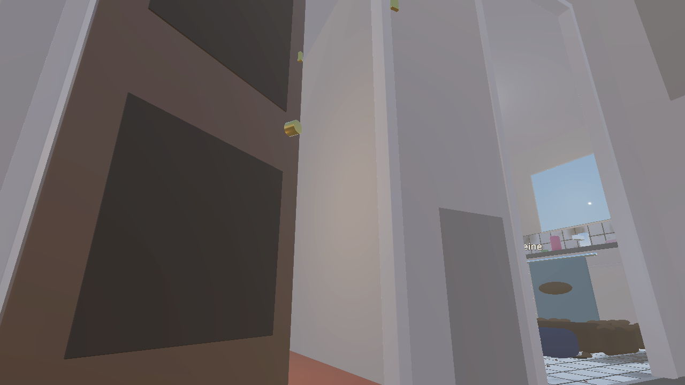 |
| Canon installé sur Nin0 | Porte de la cuisine déverrouillée |
