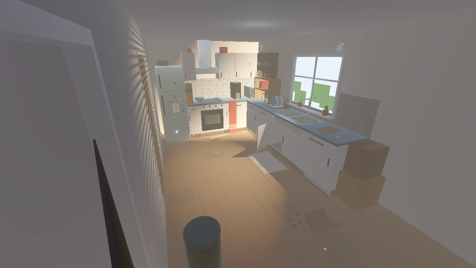
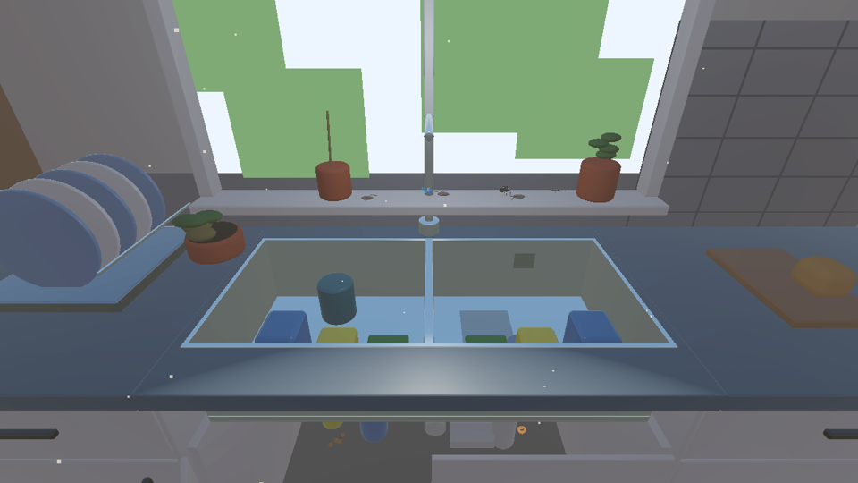
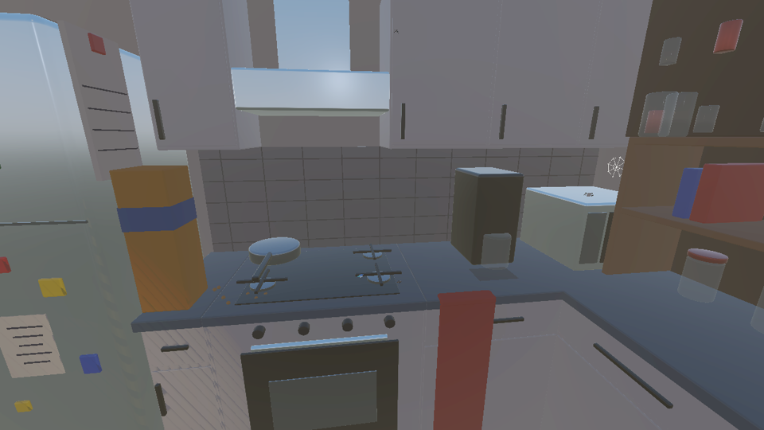
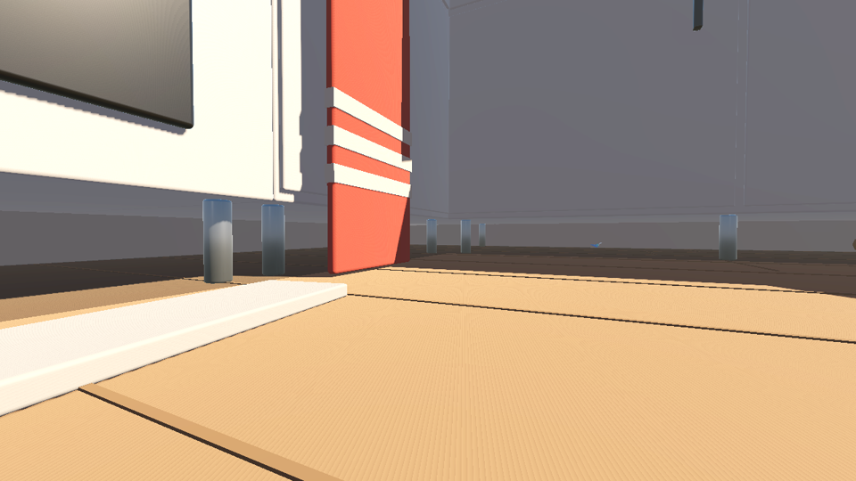
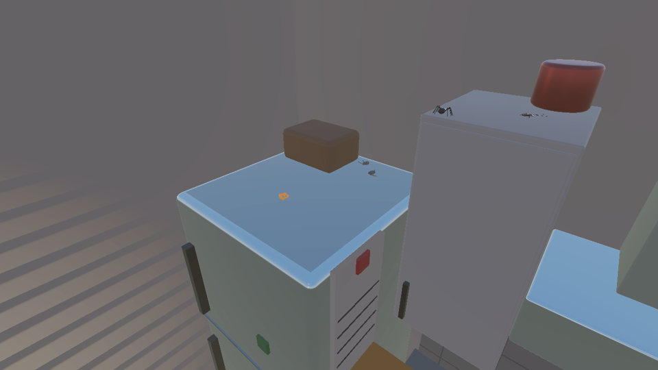
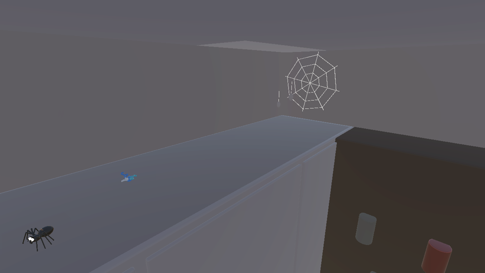
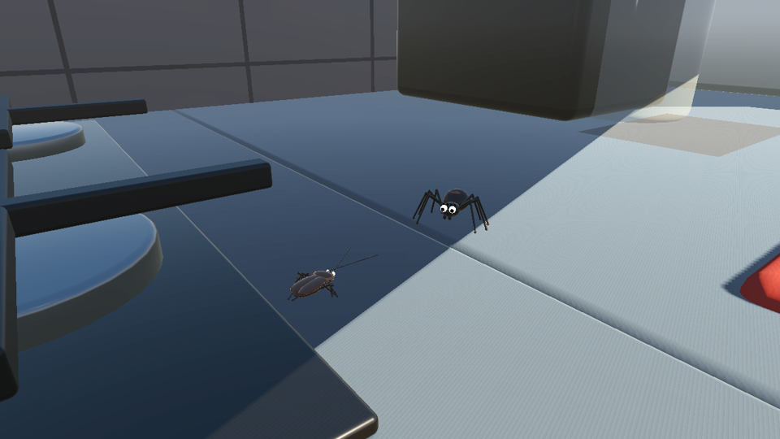

# Lot 6 — La cuisine

> Branche de travail : `claude/lot6-cuisine-finitions` (**non fusionnée**, validation du créateur attendue).
> Moteur : Godot 4.7. Nom officiel : **Nin0**.

La cuisine (zone 4) s'ouvre après le chapitre 2. Le joueur y entre par la porte entrouverte du sas ;
à la première entrée, l'écran « Chapitre 2 terminé » s'affiche puis le bouton **Entrer dans la cuisine**
rend la main. L'objectif devient « Explorer la cuisine ».

## 1. Disposition (d'après le croquis)

Cuisine compacte en L, intérieur x [-75 ; -45,6], z [0 ; 57], plafond 24 (1 u = 10 cm).

| Croquis | Monde | Contenu |
|---|---|---|
| Porte (gauche) | mur est, z 2,5 à 10,6 | porte entrouverte vers le sas ; poubelle noire à pédale juste à côté |
| Haut | mur sud (z 57) | rang de meubles bas : micro-ondes (coin), cafetière, plaque gaz 4 feux + four, hotte inox jusqu'au plafond, boîte de céréales ; placards hauts blancs à poignées noires |
| Coin haut-gauche | coin sud-est | réfrigérateur inox, aimants, liste de courses, calendrier aimanté sur le flanc |
| Droite | mur ouest (façade) | rang de meubles bas : évier double, égouttoir, grande fenêtre ; étagère ouverte (bocaux, plantes, livres) et casier à épices |
| Bas, vers la droite | sol nord-ouest | coin des cafards : carton aplati, épluchures, miettes, traînée tirée |

Matériaux : façades blanches, poignées noires, crédence en carreaux gris (joints), plan de travail gris-bleu,
parquet clair (lames). Le salon reste **fermé** (porte du mur est, examinable depuis la cuisine) ; la chambre
reste verrouillée.

Les quatre volumes provisoires du blockout (`KitchenCounter`, `KitchenUpper`, `KitchenFridge`, `KitchenTable`)
et sa lumière de zone ont été retirés ; la cuisine a son propre éclairage.

## 2. Ambiance

- Lumière chaude de la fenêtre (projecteur avec ombres) et poussière en suspension dans le rayon.
- À l'entrée de la zone, la lumière ambiante baisse de moitié et la brume s'épaissit (retour progressif en sortant) :
  les dessous de meubles, le repaire et l'interstice du réfrigérateur restent sombres.
- Traces d'abandon : poussière (sol, dessus des placards et du réfrigérateur), taches de café, moisissure au bord
  de l'évier, plinthes tombées, tasse sale, cuillère au sol.
- Végétation discrète : basilic (encore vert et déjà sec), pothos qui retombe de l'étagère, pomme de terre oubliée
  qui germe sous l'évier, plantes du rebord.

## 3. Niveaux de jeu et routes

| Niveau | Hauteur | Accès |
|---|---|---|
| Sol, dessous des meubles bas | 0 (vide de 1 u sous les caissons) | entrée ; passages sous les deux rangs |
| Intérieur du meuble sous l'évier (passage secondaire) | 1,2 | éponge-marche puis porte entrouverte |
| Plan de travail | 9,0 | **torchon** pendu (escalade) ou **pile de cartons** (deux escalades : 4,6 puis 9,0) |
| Bacs de l'évier | 7,0 | on y tombe ; on en ressort par éponge → flacon → brosse (marches de 0,5) |
| Rebord de la fenêtre | 10,2 | pot de basilic (9,6) puis saut |
| Dessus de l'étagère | 15 | flanc escaladable de l'étagère |
| Dessus des placards hauts (repaire) | 21 | casier à épices escaladable |
| Dessus du réfrigérateur | 18 | boîte de céréales (14, escalade) puis calendrier aimanté sur le flanc |

Toutes les marches à sauter font **au plus 0,6 u** (le saut des jambes monte de 1,0 u). Roues et jambes
fonctionnent partout ; l'escalade ne demande pas les jambes. Le canon reste utilisable.

Zones **visibles mais inaccessibles** (arrière-plan) : interstice entre le réfrigérateur et le mur (fermé par des câbles
et une collision invisible, dessus compris), partie est du dessus des placards (coupée par la cheminée de la hotte),
dessus du micro-ondes (bocaux au bord de l'étagère), linteau de la fenêtre.

Points de reprise : entrée de la cuisine, plan de travail ouest (sauvegardés hors mode développement).

## 4. Écosystème

### Araignée domestique (`KitchenSpider`)

Prédatrice territoriale. États : guet au repaire → petite ronde → observation (Nin0) → traque → ramassée
(annonce « ! », pattes avant levées, sifflement) → bond → récupération → emballage d'une proie → retour.
Elle descend et remonte **au bout de son fil** (embuscade depuis une hauteur), grimpe le long des façades.

- Envers Nin0 : elle le repère près de son repaire et l'observe ; s'il s'attarde (≈ 1,3 s à moins de 2,2 u, ou
  juste sous une araignée perchée), elle attaque. Morsure 16 (physique, réduite par l'Armure I), toujours annoncée
  (0,7 s) et esquivable. Au plus deux morsures, puis elle regagne son repaire ; elle laisse Nin0 tranquille un instant.
- Trois billes : retraite au repaire, puis 20 s sans s'occuper de Nin0.
- Pendant qu'elle emballe une proie, elle **ignore Nin0** : occasion de passer (exploiter les conflits).
- Repaires accessibles : dessous des meubles (coin sud-ouest), dessus des placards (descend sur le plan de travail),
  linteau de la fenêtre (descend sur le rebord).

### Cafard des bois (`KitchenRoach`)

Rapide, craintif, opportuniste. États : exploration, fouille (antennes, petits pas), fuite, cachette, défense, capturé.

- Fuit les araignées en chasse (≈ 2,6 u) et Nin0 (≈ 1,3 u) vers la **cachette la plus proche qui l'éloigne** de la menace
  (dessous de meuble, carton, derrière la poubelle, derrière les appareils…).
- Acculé : une fois sur deux il se dresse (« ! ») et pince (6, si Nin0 reste collé), sinon il tente un sprint.
- Une bille le fait détaler.
- Attrapé par une araignée : il devient un **cocon**, emporté et suspendu au repaire (trois au plus par araignée) ;
  un autre cafard réapparaît ≈ 40 s plus tard dans une cachette éloignée de Nin0.

### Relation et conflits sans Nin0

Relation asymétrique (pas deux armées) : l'araignée chasse, le cafard fuit, se cache ou se défend. Au moment du bond,
la proie remarque l'araignée (fuite ≈ 38 %, défense ≈ 12 %) ou non (capture). Une araignée se repose après chaque chasse.
Mesure du test (80 s, Nin0 immobile à l'entrée) : une dizaine de chasses avec captures, échecs, défenses et fuites.

Affrontements d'arrière-plan (créatures non hostiles envers Nin0) : derrière le réfrigérateur, dessus des placards
(partie est), dessus du micro-ondes. Le rebord de la fenêtre est un affrontement visible et accessible.

**Niveau de détail** : à moins de 14 u, comportement à chaque image ; jusqu'à 28 u, une image sur trois ; au-delà, une
sur huit et animation des corps arrêtée. Coût mesuré en test (sans rendu) : ≈ 2,2 ms par image pour toute la cuisine.

Toutes les créatures se figent pendant les séquences non interactives (`GameState.hazards_suspended`).
Elles ne bloquent jamais physiquement Nin0 (corps de tir sur la couche 32 seulement).

### Encyclopédie

Fiches `assets/species/spider.tres` et `roach.tres`, ajoutées au catalogue et analysables avec la vision focalisée.
**Aucun plan ni amélioration** n'y est attaché (`unlocks_plan` vide, inspiration mécanique vide) : les améliorations
issues des araignées et des cafards restent **à définir** par le créateur.

## 5. Traces du lieu (découvertes)

Huit découvertes, sans texte révélateur : toile habitée (repaire), vieille toile abandonnée (sous le rang ouest),
toile déchirée (fenêtre), restes de proies (dessus du réfrigérateur), cachette des cafards (meuble sous l'évier),
traînée de miettes, pomme de terre germée, plante du rebord. Toiles et cocons décoratifs complètent le décor.

## 6. Ressources

Douze ressources réparties sur tous les niveaux : filament et plastique sous les meubles, dans le meuble sous l'évier,
sur le plan de travail et la plaque, sur le rebord ; récompenses uniques sur le réfrigérateur (filament ×2),
sur l'étagère et sur le dessus des placards (plastique ×5). Inventaire, compteur de munitions et sauvegarde inchangés.

## 7. Musique

« kitchen - Nin0 » joue seule dans la cuisine (fondu enchaîné depuis « Petit Refuge »). Le salon (« living room ») reste
hors du jeu. Détail du point de boucle : `assets/music/LISEZMOI.md`. Prototype interne : ne pas distribuer.

## 8. Fichiers

- `scenes/zones/kitchen_zone.tscn` (générée), `scripts/zones/kitchen_zone.gd`
- `scripts/creatures/kitchen_creature.gd` (base : territoire, obstacles, trajets, niveau de détail),
  `kitchen_spider.gd`, `kitchen_roach.gd`, `spider_body.gd`, `roach_body.gd` (modèles procéduraux originaux)
- `assets/species/spider.tres`, `roach.tres` ; `scripts/creatures/species_catalog.gd`
- `scripts/ui/thought_icon.gd` (pictogrammes araignée, cafard, toile) ; `scripts/core/sfx.gd` (sifflement, course, fil, emballage)
- `scripts/zones/game_world.gd` (intégration, ambiance, reprise, combat, scénario), `scripts/core/game_state.gd` (objectif),
  `scripts/ui/chapter_end.gd` (bouton « Entrer dans la cuisine »), `scripts/dev/apartment_dev.gd` (Ctrl + 8)
- `scenes/levels/game.tscn`, `scenes/levels/apartment_blockout.tscn` (volumes provisoires retirés)
- `tests/test_kitchen.gd/.tscn`

## 9. Tests

`godot --headless --fixed-fps 60 --path . res://tests/test_kitchen.tscn` — 76 vérifications : navigation, salon fermé,
retour au sas, collisions des meubles, dessous praticables, toutes les routes verticales en **vraie physique**
(escalades et sauts), cafards (exploration, fuite, cachette, défense), araignées (repérage, annonce, morsure, retour,
gel pendant une séquence, retraite sous les billes, embuscade au fil, cocon, indifférence pendant l'emballage,
réapparition), écosystème autonome et arrière-plan simplifié, coût, canon, ressources, encyclopédie, découvertes,
sauvegardes et reprise, sauvegarde personnelle intacte.

## 10. Dans Godot

- Jeu normal : terminer le chapitre 2, puis entrer dans la cuisine.
- Mode développement : `scenes/levels/apartment.tscn` puis **F6**, **Ctrl + 8** (intérieur de la cuisine, canon et
  munitions fournis), ou touche **4** (zone cuisine). Aucune sauvegarde n'est écrite.
- Après un `git pull` : ouvrir le projet une fois dans l'éditeur (import des nouvelles classes et de la scène).

## À définir (créateur)

- Améliorations inspirées de l'araignée et du cafard (aucune n'est inventée ici).
- Ouverture du salon (porte toujours fermée).
- Rôle narratif éventuel de la cuisine (aucun souvenir n° 3, aucun boss ajouté).

## Captures

| | |
|---|---|
|  |  |
| Vue d'ensemble depuis la porte du sas | Évier double, égouttoir, fenêtre, meuble sous l'évier entrouvert |
|  |  |
| Rang sud : céréales, plaque gaz, cafetière, micro-ondes, étagère | Sous le rang sud : pénombre, pieds des caissons, torchon |
|  |  |
| Dessus du réfrigérateur (restes de proies) ; arrière-plan : araignée et cafard sur le placard est | Repaire de l'araignée au-dessus des placards, toile, récompense |
|  | |
| Araignée qui se ramasse face à un cafard dressé (plan de travail) | |
